<p align="center">
  
</p>

<p align="center">My personal Arch Linux install script.</p>

dejavu turns a fresh Arch install into my usual setup: my packages, my builds
of dwm, st and dmenu, my dotfiles.

```bash
./dejavu.sh                     # uses static/progs.csv
./dejavu.sh path/to/progs.csv   # uses another package list
```

Run it as your normal user, not root; it asks for your sudo password once and
keeps it alive while it runs.

## Credits

Made by Omar Gmar ([@me0mar](https://github.com/me0mar)). Inspired by
[Luke Smith](https://github.com/LukeSmithxyz) and his
[LARBS](https://github.com/LukeSmithxyz/LARBS) script.
